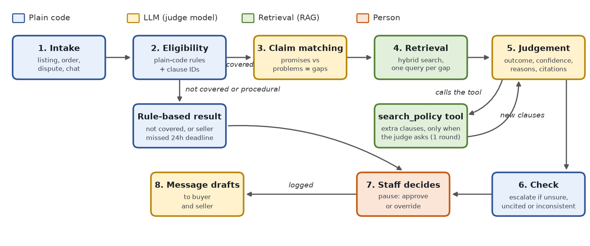

# Carousell Dispute Agent

An AI agent that helps Carousell Singapore's support team settle "significantly
not as described" disputes on second-hand items sold between individuals. It
reads the listing, the buyer's complaint, the seller's reply and the chat,
checks them against Carousell's Buyer Protection policy with retrieval-augmented
generation (RAG), and recommends an outcome with reasons and policy citations.
A staff member always makes the final decision.

BC3415 group project, Option A (working prototype + demo video).

Written report: `Carousell_Dispute_Agent_Full_Report.docx` (repo root, built from `docs/report_build/`).

**Live app:** https://bc3415-carousell-dispute-agent.streamlit.app/ (Streamlit
Community Cloud; it may take a minute to wake up if nobody has opened it for a
while).

## What it does

1. **Eligibility rules (plain code).** Paid with the 'Buy' button? Raised within the dispute window? Tracked delivery for non-receipt? Seller missed the 24-hour reply deadline? These are exact rules, so no LLM is involved, and each check cites the clause it comes from.
2. **Claim matching (LLM).** Lists what the listing promised and what the buyer reports, and pairs them up as gaps ("listing says it comes with an 8GB SD card; buyer says no card"). It writes a policy search query for each gap.
3. **Policy retrieval (RAG).** Each gap's query is run over the policy clauses. Search is hybrid: ChromaDB embeddings plus BM25 keyword scores, combined by rank fusion.
4. **Policy judgement (LLM, with a tool).** Decides whether each gap is significant and recommends one of Carousell's four outcomes: full refund with return, full refund without return, partial refund, or decline. It must cite clause IDs. If the clauses it was given do not cover a gap, it can call the **`search_policy` tool**: the model returns the tool's arguments as structured JSON, code runs the search and adds the new clauses, and the graph loops back to the judge. (A structured-output tool call rather than a provider's native function calling, so it works the same with every provider.) It is a fallback: on the test set the per-gap searches always supplied the clauses, so no model needed it; it is used when retrieval is left to the agent (see [Retrieval design](#retrieval-design-per-gap-agent-driven-or-none)).
5. **Confidence and citation check (code).** Drops citations to clauses that were not retrieved, and escalates low-confidence, unclear, uncited or self-contradicting judgements, with follow-up questions to ask for evidence.
6. **Staff decision.** The LangGraph workflow pauses until a person approves or overrides. Every decision is logged.
7. **Message drafts (LLM).** Drafts the decision messages to the buyer and the seller.

Also included:
- **A choice of judge model:** Gemini (Google cloud, free tier) or a local model through [Ollama](https://ollama.com) (nothing leaves the machine). [reports/model_comparison.md](reports/model_comparison.md) compares them. In the app, OpenAI is a fallback for when a Gemini call fails.
- **What-if policy test:** re-judges past disputes under a proposed rule change and reports how many outcomes flip.
- **Evaluation harness:** the agent against a single-prompt baseline on a held-out test set, for any judge model, plus retrieval ablations.
- **Photo checking:** an interface only (`src/dispute_agent/agent/photo.py`). Cases carry text descriptions of photos for now.



```
intake -> eligibility --covered--> claim matching -> retrieval -> judgement <-> search_policy tool
                     \                                               |
                      \                                              v
                       \                                           check -> STAFF DECIDES -> messages
                        \--not covered / procedural--> rule-based recommendation ---^
```

## Tech stack

| Part | Tool |
|---|---|
| Agent workflow, tool loop, pause for human approval | LangGraph (`StateGraph`, conditional edges, `interrupt`) |
| LLM calls with structured JSON output | Gemini API (`google-genai`), Ollama (local); OpenAI (`openai`) as the app's fallback; Pydantic schemas; an offline mock for tests |
| Policy retrieval | ChromaDB (local all-MiniLM-L6-v2 embeddings) + BM25, reciprocal rank fusion |
| Interface | Streamlit (runs locally or on Streamlit Community Cloud) |
| Environment | uv (Python 3.12 pinned, `uv.lock`), optional Docker |

## Setup

You need [uv](https://docs.astral.sh/uv/). It installs the right Python by itself.

| | Install uv |
|---|---|
| Windows | `winget install --id=astral-sh.uv -e` |
| macOS | `brew install uv` |

Then:

```bash
git clone https://github.com/J0knee10/carousell-dispute-agent-bc3415.git
cd carousell-dispute-agent-bc3415
uv sync                       # creates .venv with Python 3.12 and the locked packages
cp .env.example .env          # Windows: copy .env.example .env
```

Put a free Gemini API key (https://aistudio.google.com/apikey) in `.env` as
`GEMINI_API_KEY=...`. Without a key everything still runs in **mock mode**
(keyword rules instead of an LLM; its answers are not real judgements).

The first run downloads a small embedding model (about 80 MB) and builds the
policy index in `.chroma/`.

**Optional: a local model.** Install [Ollama](https://ollama.com/download), then
pull a model, e.g. `ollama pull qwen3:8b` (5.2 GB) or `ollama pull llama3.1:8b`
(4.9 GB). With Ollama running, the app lists it as a provider, and the CLI takes
`--provider ollama --model qwen3:8b`. An 8B model needs about 6 GB of GPU memory
to run at full speed (see [Model comparison](#model-comparison)).

**Optional: OpenAI fallback.** Add `OPENAI_API_KEY=sk-...` to `.env` (see
`.env.example`). The app then uses `gpt-5.4-mini` (low reasoning effort;
`OPENAI_MODEL` overrides it) when a Gemini call fails (below). A key on
OpenAI's free usage tier is enough: no payment method, about 50 requests a day
per model. `check-llm --provider openai` checks the key.

## Run the app

```bash
uv run streamlit run app/streamlit_app.py
```

Pages:

- **Review a dispute** works like a guided chat. Pick a demo case from the
  welcome message, open **📂 Select a case** in the bottom bar (demo,
  development, test or all cases), or type a case ID (`S01`) or words from a
  listing (`iphone`) into the chat box. Each review shows a short case card, the
  agent's steps, the recommendation with its reasons and cited clauses, and
  "How I got there" (eligibility checks, claim matching, tool calls, retrieved
  clauses). **✅ Approve** or **✏️ Override** (with a required note), and the
  agent drafts the messages to the buyer and the seller. Your name and a
  testing switch that shows the outcome each case was written for are in the
  sidebar.
- **What-if policy test**: type a proposed rule into the chat box (or click an
  example); **⚙** sets which past cases and how many. The answer gives the
  outcomes that flip and the change in buyer wins, case by case.
- **Evaluation results**: a summary for non-technical readers, with every number
  read from `reports/` (headline accuracy, the agent against the single prompt,
  why Gemini, policy search accuracy, limits); the full technical reports are
  under one expander.
- **Policy library**: search the clauses with the agent's own search, or read
  each help-centre page.
- **How it works**: the workflow figure and the eight steps in plain language.

The sidebar's **AI model** lists only the models that can run where the app is
opened.

**Gemini first, OpenAI as fallback.** The free Gemini key is the default. If
both keys are set and a Gemini call fails (free quota used up, or the service
overloaded), the app makes that call with OpenAI instead: after a daily-quota
error it stays on OpenAI for the rest of that browser session (a new session
tries Gemini first again); after any other error it goes back to Gemini on the
next call. Each recommendation shows which model judged it, marked
"(fallback)" when it was OpenAI. Our OpenAI key is unpaid (OpenAI's free usage
tier, about 50 requests a day, so roughly 15 to 25 cases), so it keeps the app
available when Gemini's quota runs out; it costs nothing and was not tested on
our test set. OpenAI is not offered as a judge in the sidebar. Evaluations from
the command line never fall back, so every number in `reports/` comes from the
model it names.

Docker alternative (no Python needed): `docker compose up --build`, then open
http://localhost:8501. The Docker files are included but were not tested on
our machines.

## Command line

All commands run as `uv run dispute-agent <command>`. Add `--provider mock` to
avoid API calls, or `--provider ollama --model llama3.1:8b` to use a local model.

| Command | What it does |
|---|---|
| `check-llm` | Checks the provider and models respond |
| `build-index [--force]` | Builds the policy search index in `.chroma/` (other commands build it when needed) |
| `run-case S01 [--approve]` | Runs the agent on one case and prints each step |
| `evaluate --split test` | Agent and baseline on the 50 held-out cases, then writes `reports/evaluation_<run>.md` |
| `evaluate ... --retrieval agentic` / `--no-retrieval` | Retrieval variants of the agent (see [Model comparison](#model-comparison)) |
| `report RUN` | Rewrites `reports/evaluation_<run>.md` from a run's saved predictions, with no LLM calls |
| `compare RUN1 RUN2 ...` | One report across runs: `reports/model_comparison.md` |
| `eval-retrieval` | Retrieval hit rates for dense, keyword and hybrid search |
| `whatif "proposed rule..." --limit 20` | Re-judges past cases under a proposed rule |
| `export-labels` / `agreement` | Labelling sheet and agreement between the two labellers |
| `sample-listings`, `generate`, `split` | Rebuild the dataset (see below) |
| `wait-for-quota --model <m>` | Waits until the Gemini free-tier quota is back |

Long jobs (`generate`, `evaluate`, `whatif`) save after every case. If the
quota runs out they stop with exit code 75; run the same command again later
and they continue where they stopped.

## Data

| Data | Source | In the repo |
|---|---|---|
| Policy text | Four Carousell SG help-centre pages, copied by hand (the site blocks automated reading) | `data/policy/*.txt`, URL on line 1 |
| Listings | 300 real listings sampled from the [Mercari Price Suggestion](https://www.kaggle.com/competitions/mercari-price-suggestion-challenge/data) `train.tsv` (US marketplace; prices converted to SGD at 1.35; condition grade 1–5 mapped to Carousell's condition names) | `data/listings/listings_sample.jsonl` |
| Disputes | 20 written by hand (`data/cases/seed_cases.yaml`) and 180 generated (`data/cases/generated_cases.jsonl`) on top of real listings | yes |
| Labels | Hand labels for the 50 test cases (B1 and B2, 25 each, in `final_outcome`); for the other cases, the outcome each case was written for (`provisional_outcome`) | `data/labels/labels.csv` |
| Retrieval test set | 25 queries with the clause text that answers each | `data/eval/retrieval_queries.jsonl` |

**How generated disputes are made.** Each case gets a scenario such as
"missing accessory" or "colour shade differs", following the brief's mix of
60% clear, 30% borderline and 10% ineligible cases. Code sets the order facts
(payment method, delivery and dispute dates), so eligibility labels are exact.
A generator model writes the complaint, the seller's reply and the chat, and
must quote the listing text the dispute is about. If the quote is not found in
the listing, it retries or switches to another listing. The generator models
(154 disputes by `gemma-4-26b-a4b-it`, 19 by `gemini-3-flash-preview` and 7 by
`gemini-3.5-flash`, used in turn as each free quota ran out) differ from every
judge model compared below, so no model grades its own writing.

To rebuild from scratch: download `train.tsv.7z` from Kaggle into `data/raw/`,
then run `sample-listings`, `generate`, `split` and `export-labels`.

## Evaluation

Details on labels are in [docs/labelling_guide.md](docs/labelling_guide.md).

- **Decision accuracy** on the 50-case held-out test set, overall and for clear, borderline and ineligible cases separately, compared with a single-prompt baseline (the whole policy pasted into one prompt, no rules, no retrieval, no agent steps). A case where the model gives no valid answer counts as wrong.
- **Eligibility accuracy**, **escalation quality** (how many wrong answers were flagged), **buyer-win vs seller-win accuracy** (a bias check), **invented citations** (before and after the agent's check), **tool use**, **time, LLM calls and tokens per case**.
- **Citation accuracy** needs a person: fill in `reports/citation_check_<run>.csv`.
- **Retrieval accuracy:** `reports/retrieval.md`.

**Labels.** Accuracy is measured against the team's hand labels
(`final_outcome` in `data/labels/labels.csv`): B1 labelled 25 test cases and B2
the other 25, on 4 Nov, after the runs. No case was labelled by both, so there
is no agreement score between the labellers. The hand labels differ from the
outcomes the cases were written for on two cases: G134 (decline instead of a
partial refund) and G147 (a partial refund instead of a decline).

### Results (judge `gemini-flash-lite-latest`)

Test set, 50 held-out cases ([full report](reports/evaluation_cmp_gemini-flash-lite.md)):

| Measure | Agent | Single-prompt baseline |
|---|---|---|
| Decision accuracy | 90% | 88% |
| clear / borderline / ineligible | 93% / 80% / 100% | 97% / 80% / 60% |
| Eligibility accuracy | 100% | 68% |
| Cases with invented clause IDs | 0% | 0% |
| Buyer-win / seller-win cases right | 83% / 96% | 96% / 81% |
| Wrong decisions escalated to a person | 2 of 5 | 1 of 6 |
| Accuracy on cases not escalated | 94% | 90% |
| Seconds per case (median) | 9.1 | 4.5 |
| LLM calls per case | 1.8 | 1 |

With Gemini the two are tied on judgement: 90% against 88%, with 5 cases only
the agent got right and 4 only the baseline got right (exact McNemar p = 1.00).
They are equal on borderline cases (80%) and the single prompt is slightly
ahead on clear ones (97% against 93%). The agent's clear gain is on
eligibility: the plain-code rules never miss a bank transfer, a late dispute or
a completed order, while the baseline called 2 of the 5 ineligible cases
eligible and marked 14 eligible cases ineligible. The 100% eligibility shows
the rules are implemented correctly; on our data it is guaranteed, because the
cases' order facts were generated from the same rules. The agent's review step
sends 2 of its 5 mistakes to a person; the baseline has no review step and
counts as escalated only when its confidence is below 0.7, so those escalation
figures measure different things, and the 94% on cases not escalated includes
the 5 ineligible cases the rules decide. The baseline leans towards refunding
(81% of seller wins right); the agent leans towards declining (83% of buyer
wins, 96% of seller wins).

**AI-assisted checks (not human).** Claude, an AI model separate from every
judge model here, did two checks. Its answers are in their own columns and
never replace the human ones:

- *Citation check:* 61 of the agent's 68 citations (90%) support the decision
  they are cited for (`claude_supports` in
  [the citation sheet](reports/citation_check_cmp_gemini-flash-lite.csv)). Most
  misses cite a procedural clause (how a return works), or a clause listing
  what *is* covered on a decline. No person has checked the citations yet.
- *Labels:* Claude also labelled the 50 test cases (`claude_*` in
  `data/labels/labels.csv`). It agrees with the hand labels on 47 of 50 (Cohen's
  kappa 0.90); the differences are G059, G129 and G147, all judgement calls.
  Treat this with caution: Claude also helped build this project.

### Model comparison

The professor asked us to try different models. We compared the free cloud
model with two open models running locally, under the same prompts, cases and
code ([full tables and notes](reports/model_comparison.md)). OpenAI is not part
of the comparison: it is only the app's fallback, and our key's free usage tier
(about 50 requests a day) is far short of the roughly 500 requests a test run
with its ablations needs.

| Judge model | Runs on | Agent | Single prompt | Agent gain | Paired test | Seconds per case (agent) |
|---|---|---|---|---|---|---|
| `gemini-flash-lite-latest` | Google cloud, free tier | **90%** | 88% | +2 pts | 5 vs 4 cases, p = 1.00 | 9 (includes free-tier pacing) |
| `llama3.1:8b` | our PC, Ollama | 54% | 34% | +20 pts | 17 vs 7 cases, p = 0.06 | 15 |
| `qwen3:8b` (thinking off) | our PC, Ollama | 52% | 44% | +8 pts | 6 vs 2 cases, p = 0.29 | 19 |

Paired test: cases only the agent got right vs cases only the single prompt got
right, exact McNemar test. Single runs on 50 cases.

**Hardware constraints.** The local models ran on one desktop: Intel Core
i5-13400F, 32 GB RAM, NVIDIA RTX 4060 Ti with 8 GB of GPU memory, Windows 11.
8 GB of GPU memory limits us to models of about 8 billion parameters at 4-bit
quantisation (about 5 GB of weights). A 16k-token context window pushed 13% of
Llama onto the CPU, so we used 10,240 tokens, which fits the largest prompt
(6,800 tokens); Qwen took 6.9 GB at this window and ran 11% on the CPU. Larger
open models (14B and up) would have run largely on the CPU, several times
slower, and all runs had to finish in one night, so we kept to two 8B models.
Each local run of 50 cases took about 15 to 30 minutes.

**What we found.**

- **Gemini is far better at the judgement.** The local 8B models get about half the cases right, and their failure is one-sided: of the 21 eligible test cases that should be declined, Gemini's agent refunded 1, Llama's 19 and Qwen's 20, including change-of-mind and damage-after-delivery claims. They do not apply the policy's exclusions.
- **The agent is ahead of the single prompt with every model, but no gap is statistically significant on 50 cases** (largest: Llama, +20 points, p = 0.06; with Gemini it is a tie, p = 1.00). The eligibility rules in code are 100% right with every model (the single prompt: 68%, 86%, 90%), and on clear cases Llama goes from 37% to 60%. Neither local model is usable either way.
- **Citations:** the agent's final answers never cite a clause the judge was not shown, with any model. Before that check, Qwen cited BPR-05, a real clause it had not been given, in 10 of 45 judged cases; the check removed it and escalated those cases.
- **Escalation:** Gemini's agent escalates 6% of cases (asking for more evidence, or low confidence) and 2 of its 5 mistakes are among them. Qwen's 22% is almost entirely those BPR-05 citations, not low confidence; the local models never reported low confidence on their mistakes, so with them escalation protects only against bad citations.

**Our conclusion.** Gemini Flash-Lite is the judge: it is by far the most
accurate of the models we tested (90% against 54% and 52%, and 94% on the cases
it does not escalate), and it is free. The local 8B models are not good enough
to judge disputes on their own: they refund nearly every dispute, which hurts
honest sellers. Llama 3.1 8B is the default local model (level with Qwen,
faster, and it fits fully on our GPU) for when case data must stay on the
machine, as an option, not a replacement. OpenAI GPT-5.4 mini only keeps the
cloud app running when Gemini fails; it is not a tested judge.

### Retrieval design: per gap, agent-driven, or none

Does retrieval change the decisions, or only the citations? We ran three
designs of the agent on the local models and probed Gemini on 10 cases
([notes and tables](reports/model_comparison.md)):

| Retrieval design | Llama 3.1 8B | Qwen 3 8B |
|---|---|---|
| Per gap (default): one search per gap, `search_policy` as a fallback | 54% | 52% |
| Agent-driven: general clauses only; a planning step calls `search_policy` for the gaps they miss | 54% | 52% |
| None (ablation) | 64% | 56% |

- **With our full decision guide, retrieval does not help the local models** (without it Llama gets 5 more cases right and Qwen 2). The guide in the judge's prompt restates the policy's covered and not-covered lists, so the judge has the rules even without retrieval; the next section removes them.
- **Without retrieval the citations are made up.** Both models still cited a clause in every case, almost always "BPR-02", the example ID in the prompt (40 of 48 citations for Llama, 45 of 46 for Qwen). The check removes them and escalates the case.
- **Tool use.** In the default design no model needed `search_policy` on the test set: the per-gap searches already found the clauses. Offered as an optional field inside the judgement, the tool was never used, even when the per-gap searches were removed (0 of 40 judged Llama cases, 0 of 10 Gemini cases; [details](reports/tool_field_experiment.md)). With a separate planning step it is: Llama searched in every case, Qwen in 9%, Gemini in 3 of 10 (each time for a gap the general clauses missed), and Gemini matched the per-gap design on those 10 cases.
- **Choice:** per-gap retrieval stays the default. It is as accurate, one LLM call cheaper per case, and predictable; the tool stays as a fallback.

### Does retrieval matter when the prompt does not restate the policy?

Our decision guide restates the policy's covered and not-covered lists, so the
judge has the rules even without retrieval. A **rubric-only** guide
(`--guide rubric`) keeps only our outcome rubric, so what is covered has to come
from the retrieved clauses ([details](reports/model_comparison.md)):

| Decision guide, retrieval | Llama 3.1 8B (50 cases) | Qwen 3 8B (50 cases) | Gemini Flash-Lite (first 25 cases, all clear ones) | Where the coverage rules come from |
|---|---|---|---|---|
| Full guide, per gap (default) | 54% | 52% | 92% (23 of 25) | The prompt and the retrieved clauses |
| Full guide, no retrieval | 64% | 56% | not run | The prompt only |
| Rubric only, per gap | 58% | 54% | 92% (23 of 25) | The retrieved clauses only |
| Rubric only, no retrieval | 60% | 58% | 88% (22 of 25) | Nowhere: only the outcome rubric and the model's own knowledge |

- **The local models cannot tell us:** every 8B variant lands at 52–64% (a spread of 6 cases), gets only 23–38% of seller wins right, and refunds almost everything, whatever the prompt holds.
- **For Gemini, retrieval can replace the restated policy** (23 of 25 either way). Without retrieval it declined two missing-accessory claims (G008, G043) that the policy covers, and it could cite nothing, so every case went to a person.
- **Conclusion:** on this test set retrieval is not what makes the decisions accurate (Gemini mostly knows the rules); its value is grounding every recommendation in a clause staff can check, putting coverage the model would miss in front of it, and letting a policy change be handled by re-indexing the text. The Gemini probe covers only the first 25 test cases, which are all clear cases (no borderline ones).

### How we got here

**The decision-guide fix.** The first test run
([report](reports/evaluation_gemini_test.md)) gave agent 82%, baseline 84%.
Both declined every small undisclosed flaw on items listed as new or like new,
because two lines of the decision guide contradicted each other. We clarified
the rule and checked the change on dev cases only (agent 81% to 89%, baseline
78% to 81%; [before](reports/evaluation_dev_borderline_v1.md),
[after](reports/evaluation_dev_borderline_v2.md)), then re-ran the test set
([report](reports/evaluation_gemini_test_v2.md): agent 88%, baseline 90%;
the fix helped both). Every test-set report, these early runs included, is
scored against the hand labels; the dev cases were not labelled by hand, so
the dev numbers use the outcomes the cases were written for.

**The tool, the model comparison and the hand labels.** We then added the
`search_policy` tool and ran the test set a third time, now once per judge
model; the team then labelled the test set by hand, and all current numbers use
those labels (they put Gemini's agent at 90%, the single prompt at 88%).
Nothing was tuned on the test set between these runs, but it has
now been used three times, and the default local model was chosen from these
results, so its test numbers are slightly optimistic.

## Limitations

- Disputes are synthetic and may be easier than real ones; the generator sees the scenario and the target outcome it should support.
- 50 test cases is small: one case moves accuracy by 2 points.
- Policy text comes from four help-centre pages copied on 28 Oct 2026; Carousell may change them.
- Listings are from a US marketplace (Mercari), not Carousell.
- When to give a partial refund rather than a return is our own rubric (see `DECISION_GUIDE` in `src/dispute_agent/agent/prompts.py`); Carousell's policy does not spell it out.
- Free-tier Gemini may use prompts to improve Google's products; all data here is made up or public. A real deployment would remove personal details and use a paid tier or a local model.
- LLM answers can vary between runs even at temperature 0.
- The local models were limited by an 8 GB GPU (see [Hardware constraints](#model-comparison)), so "cloud vs local" is also "strong small cloud model vs 8B models": the comparison cannot separate the two.
- The app's OpenAI fallback (`gpt-5.4-mini`) was not evaluated on the test set, and on the free usage tier it covers only about 50 requests a day.
- Single runs, no repeat runs to measure variation. Each test case was hand-labelled by one person (no agreement score), after the runs; no person has checked the citations yet.
- Paused reviews live in memory (LangGraph `InMemorySaver`), so a restart of the app loses cases waiting for a staff decision; the decision log is a local file.

## Project layout

```
app/streamlit_app.py          staff interface
src/dispute_agent/
  agent/                      LangGraph graph (with the search_policy tool loop), eligibility rules, prompts, runner
  rag/                        clause chunker, ChromaDB + BM25 store
  llm/                        Gemini, Ollama and OpenAI (fallback) clients, mock, fallback logic
  data/                       Mercari sampler, case loading, generator, labels
  evaluation/                 harness, metrics, report, model comparison, retrieval eval, what-if
  cli.py                      command line
config.yaml                   models, retrieval, agent, data and output settings
data/                         policy text, listings, cases, labels, eval queries
docs/
  labelling_guide.md          how to label cases
  model_comparison_notes.md   written conclusions at the top of reports/model_comparison.md
  figures/                    workflow figure and the script that draws it
  report_build/               scripts that build the report
reports/                      evaluation reports and the model comparison
outputs/
  runs/                       per-case predictions behind every report
  runs_discarded/             the runs reports/tool_field_experiment.md cites
  whatif/                     the what-if demo run
presentation/VIDEO_SCRIPT.md  demo video script (all six members, about 4:55)
tests/                        pytest suite (runs offline: mock LLM, faked HTTP)
Dockerfile / compose.yaml     optional container for the app
Carousell_Dispute_Agent_Full_Report.docx
                              the written report (built from docs/report_build/)
```

Run the tests with `uv run pytest` (69 tests, no network or API key needed; they write their outputs to a temporary folder).

## Deploying to Streamlit Community Cloud

Deployed on 6 Nov 2026 at https://bc3415-carousell-dispute-agent.streamlit.app/.
Every push to `main` redeploys it within a minute or two. The app reads the keys
from Streamlit secrets, installs from `requirements.txt`, and hides the Ollama
option when no local server is running. To deploy your own copy:

1. Push the repo to GitHub (a private repo works; Streamlit asks for access to it).
2. Sign in at https://share.streamlit.io with GitHub and click **Create app** → **Deploy a public app from GitHub**.
3. Repository `J0knee10/carousell-dispute-agent-bc3415`, branch `main`, main file path `app/streamlit_app.py`.
4. Open **Advanced settings**: choose Python **3.12**, and under **Secrets** paste:
   ```toml
   GEMINI_API_KEY = "your-gemini-key"
   OPENAI_API_KEY = "sk-your-openai-key"
   ```
   Gemini is used first; OpenAI only when a Gemini call fails (an unpaid key on OpenAI's free usage tier is enough). Leave out the OpenAI line to run on Gemini alone.
5. Click **Deploy**. The first start takes a few minutes (it installs the packages and downloads the 80 MB embedding model).

On the cloud the app offers Gemini and mock (no Ollama), with OpenAI as
Gemini's fallback. Everyone who opens the link shares the free Gemini quota
(about one full test run a day for `gemini-flash-lite-latest`; it resets at
midnight Pacific time, 4 PM in Singapore), then the OpenAI fallback's free
usage tier (about 50 requests a day). Files on Community Cloud do not survive a
restart, so the decision log starts again from zero.
After changing dependencies, regenerate `requirements.txt` with
`uv export --no-hashes --no-dev --no-emit-project -o requirements.txt`.

## Team and contributions

Evidence can be commits, files, documents or meeting notes; the commit history alone shows one author because the code was
pushed from one machine.

| Member | Role | Main contributions | Evidence | In the video |
|---|---|---|---|---|
| Ronak | C1: Agent lead | LangGraph workflow, tool loop, confidence check, staff pause | `src/dispute_agent/agent/` | How it works (0:50–1:25) |
| Akshaya | C2: RAG and policy | Policy clauses, hybrid search, citations, retrieval evaluation | `src/dispute_agent/rag/`, `reports/retrieval.md` | The policy search (1:25–1:40) |
| Evelyn | C3: Data and evaluation | Listings, dispute generator, labels, harness, baseline, model comparison | `src/dispute_agent/data/`, `src/dispute_agent/evaluation/`, `reports/` | Does it work? (3:00–3:55) |
| Jonathan | C4: App and deployment | Streamlit app, local models, cloud deployment, repo and README | `app/`, `src/dispute_agent/llm/`, `README.md` | Live demo (1:40–3:00) |
| Dan Yu | B1: Business lead | Problem, evidence, competitors, business case, recommendation | Project Brief, Business Case | Problem; recommendation (0:00–0:50, 4:20–4:50) |
| Drue | B2: Policy and story lead | Policy corpus, hard cases, labelling, risks and ethics, video editing | `data/policy/`, `data/labels/labels.csv`, `presentation/` | Risks (3:55–4:20); edits the video |

## Before submission

The team's remaining tasks are in [NEXT_STEPS.md](NEXT_STEPS.md).
